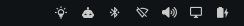
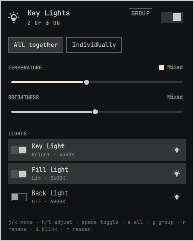
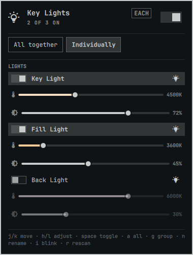

# Elgato Key Light for Omarchy

An Elgato Key Light control panel for the Omarchy 4 bar.

Power, brightness, and color temperature for one light or a whole set — as a
group or individually — from a bar widget that looks and behaves like the
first-party ones.



| All together | Individually |
| --- | --- |
|  |  |

## What it does

- **Quick on/off.** Right-click the bar icon, or hit the master switch in the
  panel. Scroll on the icon to change brightness without opening anything. The
  icon dims when every light is off, so the bar reads at a glance without
  claiming your attention.
- **Group or individual.** One pair of sliders for every light at once, or a
  compact pair per light. The bar glyph fills in as the lights get brighter.
- **Persistent names.** Rename a light and the name is written to the light's
  own flash — so it survives reboots, follows the light to another machine, and
  matches what Elgato's Control Center shows.
- **Blink to identify.** With several lights on a desk, the only reliable way
  to tell which row is which fixture.
- **Keyboard driven.** The panel is fully navigable without a mouse.
- **Themed.** Colors, font, corner rounding, and border weights all come from
  the active Omarchy theme, so `omarchy theme set` restyles it live.

## Install

```bash
omarchy plugin add https://github.com/nille/omarchy-elgato-keylight --enable
```

`--enable` puts it straight into the bar's right section. Without it, add it
later via **Omarchy menu → Bar → Widgets**, or with:

```bash
omarchy plugin enable nille.elgato-keylight --section right
```

No build step, no compiled binary, and nothing to install as root. The helper is
a single Python 3 standard-library script, which is what lets `omarchy plugin
add` — which deliberately never runs plugin code or install hooks — set this up
end to end.

### Uninstall

```bash
omarchy plugin remove nille.elgato-keylight
```

Nothing is left behind: no daemon, no unit file, no state outside the plugin
directory and its entry in `~/.config/omarchy/shell.json`. Names you set live on
the lights themselves, so they survive uninstalling — and reappear in Elgato's
own apps.

### Requirements

- Omarchy 4 (the Quickshell bar)
- Python 3.9+ (already present on Omarchy)
- `avahi-daemon` running, for automatic discovery. Omarchy installs `avahi` as
  part of its base packages, but only *enables* the daemon if you set up a
  printer, so it may be present and inactive:

  ```bash
  systemctl is-active avahi-daemon || sudo systemctl enable --now avahi-daemon
  ```

  Optional either way — set `hosts` to pin addresses instead.

## Settings

| Key | Default | What it does |
| --- | --- | --- |
| `hosts` | `""` | Comma-separated addresses, e.g. `192.168.1.10, 192.168.1.11`. Skips discovery entirely. Set this if mDNS is blocked on your network or you want a fixed order. |
| `refreshIntervalSec` | `30` | How often to re-read state while the panel is open. |
| `groupMode` | `true` | Start with all lights ganged together. |
| `hideWhenAbsent` | `false` | Remove the bar icon when no lights are found, instead of showing a dimmed one. |

```json
{
  "id": "nille.elgato-keylight",
  "hosts": "192.168.1.10, 192.168.1.11",
  "groupMode": false
}
```

Or from the CLI, without editing the file:

```bash
omarchy bar set nille.elgato-keylight hosts "192.168.1.10, 192.168.1.11"
omarchy bar set nille.elgato-keylight refreshIntervalSec 60 --json
omarchy bar set nille.elgato-keylight groupMode false --json
```

`--json` is what distinguishes the number `60` and the boolean `false` from the
strings `"60"` and `"false"`.

## Using it

### Mouse

| Action | Result |
| --- | --- |
| Left-click icon | Open the panel |
| Right-click icon | Toggle every light |
| Middle-click icon | Rescan the network |
| Scroll icon | Group brightness |
| Left-click a row | Toggle that light |
| Right-click a row | Rename it |
| Blink button on a row | Flash that light so you can find it |

### Keyboard

| Key | Result |
| --- | --- |
| `j` / `k` | Move the cursor |
| `h` / `l` | Adjust the slider under the cursor |
| `space` | Toggle |
| `a` | All lights on/off |
| `g` | Group ⇄ individual |
| `n` | Rename the light under the cursor |
| `i` | Blink the light under the cursor |
| `r` | Rescan |
| `Esc` | Close |

### Hyprland bindings

Everything is reachable over IPC, so you can drive the lights without opening
the panel. Add to `~/.config/hypr/bindings.conf`:

```
bind = SUPER SHIFT, L, exec, quickshell -p $OMARCHY_PATH/shell ipc call nille.elgato-keylight lightsToggle
bind = SUPER ALT,   L, exec, quickshell -p $OMARCHY_PATH/shell ipc call nille.elgato-keylight toggle
```

Available calls: `open`, `close`, `toggle`, `lightsOn`, `lightsOff`,
`lightsToggle`, `brightness <0-100>`, `kelvin <2900-7000>`, `identify <host>`,
`rescan`, `state`. Quickshell requires every argument, so pass `identify ""` to
blink the first light.

## The helper CLI

`scripts/keylight` is usable on its own, and prints JSON on stdout for every
subcommand:

```bash
scripts/keylight discover                                  # find lights
scripts/keylight state                                     # read them
scripts/keylight set --brightness 60 --kelvin 4500         # all of them
scripts/keylight set --host 192.168.1.10 --off             # just one
scripts/keylight rename --host 192.168.1.10 "Left Key"
scripts/keylight identify --host 192.168.1.10
scripts/keylight firmware                                  # installed versions
```

Every subcommand exits 0 and reports failure as `{"ok": false, "error": ...}`,
including when a light is unplugged. The panel is a UI, not an error handler: it
should never have to tell "the helper crashed" apart from "the light is asleep",
so both arrive as data.

## Firmware

Each light's installed version shows in its row tooltip, and
`scripts/keylight firmware` prints it. Compare it against [Elgato's release
notes](https://help.elgato.com/hc/en-us/sections/360004115951-Elgato-Control-Center-Software)
to see whether you are current.

The panel never says an update is *available*, and there is no "check for
updates" button. Elgato publishes no machine-readable firmware feed and no
downloadable images, so such a control would behave identically whether you were
current or three versions behind — a notification carrying no information is
worse than no notification.

Updating is deliberately out of scope, and the helper has no flash command. The
Elgato phone apps update over Bluetooth and need no desktop at all, which is the
easiest supported path; Control Center on Windows or macOS also works. Reporting
the version stays strictly read-only, because the light's own update routes erase
its staging flash just by being addressed.

## Files

- `manifest.json` — plugin id, bar widget metadata, settings schema and defaults
- `Panel.qml` — bar glyph, popout, cursor model, IPC. Every control is a `qs.Ui`
  component, so nothing about the look is hardcoded here
- `Model.js` — pure functions: parsing, clamping, labels, argv building. No QML
  types, no state, no side effects, which is what makes it testable
- `scripts/keylight` — the helper CLI: mDNS discovery, HTTP, concurrency
- `tests/test_keylight.py` — 71 unit tests over the helper
- `tests/harness/shell.qml` — standalone window for developing the panel without
  a running Omarchy shell
- `preview.png` — composite of the screenshots below, at the repository root
  because that is where the plugin marketplace looks for a listing image

## How it works

Lights speak HTTP on port 9123 and advertise themselves as `_elg._tcp`.
Temperature travels the wire in mired (`mired = 1e6 / kelvin`); the panel works
in Kelvin and snaps to 50K stops, because the round trip is lossy and unsnapped
values make the readout jitter. Discovery is cached, since it costs about a
second of network waiting and is the difference between a panel that opens
instantly and one that hangs.

Values are applied optimistically while you drag and reconciled from the
hardware shortly after, so the slider tracks your finger but still ends up
showing what the firmware actually accepted — including changes made from
another app.

## Verify

```bash
omarchy plugin validate .
python3 -m unittest discover -s tests
```

`plugin validate` runs the same manifest checks the shell enforces at load time,
so it fails before an install does. The unit tests never touch a real light.

To work on the panel itself without installing it, the harness stands in for the
bar:

```bash
quickshell -p tests/harness/shell.qml
```

Note that `omarchy plugin add` and `plugin validate` both refuse symlinks
anywhere inside a plugin folder, so a working tree has to be copied into
`~/.config/omarchy/plugins/` rather than linked — the harness exists to avoid
needing that at all.

## A note on the network API

The Key Light's HTTP API is unauthenticated, which is a property of the
hardware rather than of this plugin — see
[CVE-2025-7202](https://www.toreon.com/flashing-your-lights-cve-2025-7202/).
Anything on your network can already control your lights. Worth knowing if you
run one on a network you do not trust.

## Contributing

Issues and pull requests are welcome. Two things worth knowing before you start:

- **Only one Key Light was available to develop against.** Multi-light behavior
  is covered by unit tests and by mocking the helper, not by hardware. If you own
  several, reports about group mode and per-light rows are the most useful thing
  you can send — especially mixed states across different firmware versions.
- **Keep logic out of QML.** Parsing, clamping, and argv building belong in
  `Model.js` as pure functions, which is what makes them testable without a
  running shell. `Panel.qml` should stay presentation.

Run `python3 -m unittest discover -s tests` and `omarchy plugin validate .`
before opening a PR. Please do not hardcode colors, fonts, or spacing — every
value comes from the active Omarchy theme via `qs.Ui`, and a literal breaks
theming for everyone else.

## License

MIT. See [LICENSE](LICENSE).

Not affiliated with or endorsed by Elgato / Corsair.
